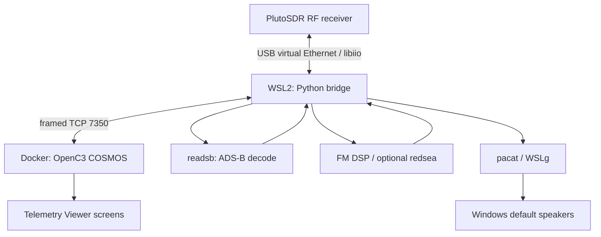

# PlutoSDR + OpenC3 COSMOS — Development Guide

> **Purpose:** Technical handoff for the next developer, future ChatGPT session, or project maintainer. This is a companion to [README.md](README.md), **not** a replacement for it.
>
> **Baseline reviewed:** v0.7.0 source/package and the public repository README, 2026-10-23. The Python test suite passed **28 tests** in the reviewed local package. Actual installed source may advance; check `git status`, `git log` and the files in `pluto-cosmos-starter/` before editing. The operator has verified live spectrum/ADS-B/FM operation; not every optional RDS behavior has been independently validated over the air.

## In one minute

PlutoCOSMOS is a **receive-only** integration of the ADALM-PLUTO SDR and OpenC3 COSMOS. OpenC3 runs via Docker Desktop on Windows, a Python bridge runs in Ubuntu/WSL2, and the Pluto appears as a libiio network device, normally `ip:192.168.2.1`. COSMOS provides all controls, charts, aircraft tables, and map views. The bridge handles hardware access, DSP and external decoders. Audio leaves WSL2 through PulseAudio/WSLg and plays on Windows speakers; it **does not** pass through COSMOS.

Three mutually exclusive modes currently exist:

| Mode | Receiver owner | DSP / external service | COSMOS display |
| --- | --- | --- | --- |
| Spectrum | Bridge (`pyadi-iio`) | NumPy FFT, peak hold, PNG waterfall | `spectrum.txt` |
| ADS-B 1090 MHz | `readsb` | Mode S/ADS-B decode, `aircraft.json` poll; bridge creates map PNG | `adsb.txt` |
| Broadcast FM 88–108 MHz | Bridge (`pyadi-iio`) | FM composite, stereo/mono, audio FFT, optional `redsea` | `fm.txt`; sound through WSLg |

### Start the last-known working configuration

From the **`pluto-cosmos-starter/`** directory, with its virtual environment active:

```bash
python3 bridge/pluto_bridge.py \
  --uri ip:192.168.2.1 \
  --readsb-path "$HOME/readsb/readsb" \
  --redsea-path "$HOME/redsea/build/redsea" \
  --fm-allow-extended \
  --verbose
```

`--redsea-path` is optional if RDS is not installed or used. The bridge listens on `0.0.0.0:7350` by default; the COSMOS interface `PLUTO_SDR_INT` is configured for `host.docker.internal:7350`. Start one bridge instance at a time. If troubleshooting, first try simulation: `python3 bridge/pluto_bridge.py --simulate --verbose`.

### How to resume work in a new chat

1. Give the assistant this repository: <https://github.com/dlinds51/plutoCosmos>.
2. Ask it to read `README.md`, **this file**, `ROADMAP.md`, `docs/PROTOCOL.md`, and `docs/HANDOFF.md`, then inspect the **current** Python bridge, plugin definition files, and tests.
3. Specify the current deployed version and your next desired change. Share fresh logs or a screenshot if diagnosing a problem.
4. Ask for **minimal changes**, regression tests and a ready-to-install plugin `.gem` when COSMOS files change.
5. Do **not** assume a downloaded artifact from an earlier chat is newer than GitHub. Compare `git log`, source files and the installed plugin version.

## Repository layout and source-of-truth rules

```text
plutoCosmos/
├── README.md                       # User-facing project overview/setup
├── DEVELOPMENT.md                  # This engineering handoff
├── CHANGELOG.md                    # Shipped milestones
├── ROADMAP.md                      # Planned/not-yet-shipped work
├── docs/
│   ├── HANDOFF.md                  # Short next-session checklist
│   ├── PROTOCOL.md                 # Wire protocol and packet IDs
│   └── RELEASE_CHECKLIST.md        # Testing and release process
└── pluto-cosmos-starter/
    ├── bridge/
    │   ├── pluto_bridge.py         # TCP service, commands, mode transitions
    │   ├── adsb.py                 # readsb wrapper, aircraft normalization/map
    │   ├── fm.py                   # FM settings, audio subprocess, status
    │   ├── fm_stereo.py            # Stereo/pilot DSP, L/R audio spectrum
    │   ├── rds_stream.py           # Asynchronous redsea integration
    │   ├── requirements.txt        # Python dependencies
    │   ├── test_audio.py           # WSLg speaker smoke test
    │   └── test_stereo_audio.py    # Stereo speaker smoke test
    ├── cosmos-plugin/
    │   ├── openc3-cosmos-plutosdr.gemspec
    │   ├── plugin.txt             # TARGET and TCP interface definition
    │   ├── targets/PLUTO_SDR/
    │   │   ├── cmd_tlm/cmd.txt     # COSMOS command schemas
    │   │   ├── cmd_tlm/tlm.txt     # COSMOS telemetry schemas
    │   │   └── screens/{spectrum,adsb,fm}.txt
    │   └── openc3-cosmos-plutosdr-<version>.gem
    └── tests/                      # unittest regression/simulated TCP tests
```

**Authoritative protocol definitions:** `bridge/*.py` packet builders/parsers and `cosmos-plugin/targets/PLUTO_SDR/cmd_tlm/{cmd,tlm}.txt`. The bridge and plugin **must** agree on lengths, type IDs, ordering, data types and byte order. `docs/PROTOCOL.md` is an explanatory index; update it after changing those sources.

**Authoritative deployed behavior:** user-verified logs/screens and current checked-out Git source. The base README and docs can lag the implementation; update them in the same release.

## Architecture and networking



- **COSMOS → bridge:** commands over one length-framed, big-endian TCP socket.
- **Bridge → COSMOS:** low-rate telemetry: FFT arrays, status, base64 PNG images, decoded aircraft, FM status/RDS. **No raw RF I/Q or PCM audio** in COSMOS packets.
- **Bridge ↔ Pluto:** `pyadi-iio` / native libiio. Hardware URI defaults to `ip:192.168.2.1` but is configurable.
- **Docker ↔ WSL2:** COSMOS `plugin.txt` uses `host.docker.internal`; Windows localhost forwarding and Docker networking must be available.
- **Audio:** `pacat --playback --raw --format=s16le --rate=48000 --channels=2` receives PCM from bridge; PulseAudio/WSLg forwards to Windows. `pulseaudio-utils` is an **APT**, not pip, dependency.

### Device ownership and state-machine invariants

**This is the most important design rule.** The original Python spectrum source and `readsb` must not own the Pluto RX simultaneously.

- **Spectrum → ADS-B:** pause FFT acquisition → `InputSource.release()` (destroy DMA buffer/drop IIO context) → start `readsb` → poll aircraft JSON → emit table, events and map.
- **ADS-B → Spectrum:** terminate/wait for `readsb`, reclaim Pluto via `InputSource.configure(cfg)`, resume FFT stream, reset peak hold/waterfall as appropriate.
- **Spectrum → FM:** stop spectrum, configure Pluto for FM acquisition, run `FMStereoDemodulator`, send audio to `WSLgAudio`, optionally feed `RDSService`; use one exclusive receiver path.
- **FM → Spectrum / ADS-B:** stop audio and optional RDS subprocess cleanly; release/reconfigure RX as needed **before** starting next owner.
- **COSMOS disconnect:** clean up external subprocesses and restore a usable idle/spectrum state. Inspect the `finally` block in `serve()` before changing mode logic.
- **Receiver reconfiguration:** changing only `rx_lo` must **not** unnecessarily destroy the DMA buffer. Only sample-rate and buffer-size changes require that disruption. This was the root of an early Apply Settings instability.

**On every mode change, think through:** software stop, process termination, IIO context ownership, buffer lifetime, telemetry reset/staleness, and exception/rollback path. Maintain exactly one active radio owner.

## DSP and protocol specifics

### Spectrum

- Default: 915 MHz, 2 MSPS, 1.6 MHz *display span*, 1.6 MHz RF bandwidth, 2048-point FFT, 8 averages, gain 40 dB, AGC off, 2 updates/s.
- Windowed FFTs are averaged in linear power (not averaged in dB), cropped to span, interpolated into **512 bins**.
- Relative amplitude is **dBFS-like** based on approximate receiver full scale, **not calibrated dBm**. Actual horizontal axis in `ARRAYPLOT` is 0–511; left/center/right MHz arrive as separate fields.
- Waterfall: 256 frequency bins × 96 history rows, PNG generated in bridge and rendered by native COSMOS `IMAGEVIEWER`. Newest samples are at the top. Rate-limit image transmission to around 1 Hz.
- **Span** is a visualization crop; **RF bandwidth** controls hardware receive filtering. Do not merge them again.

### ADS-B

- `readsb` must be built with `PLUTOSDR=yes` and pointed at `--pluto-network 192.168.2.1` (or current URI host).
- Its subprocess environment **must** include `IIOD_REMOTE=ip:192.168.2.1` (derived from bridge `--uri`). In WSL2, default libiio context selection produced `Context has 2 device(s)` and `readsb` segmentation faults; explicitly selecting the Pluto solved it. See `ADSBRuntime.start()` in `adsb.py`.
- Reads JSON produced by `readsb` (~1 s interval), normalizes fields, emits a fixed 12-row table and individual update events. Missing positions/altitude remain `-`, not zero.
- Map: bridge-generated PNG, fixed latitude/longitude region centered on configurable **example reference station**, home marker, named landmarks, per-aircraft trails (~15 min), `Clear Tracks` command.
- Default demonstration map reference point is **39.079046981923796, -104.86428665378747**. This is a representative point selected for testing, **not an assertion of a person's address or actual receiver location**. Never label it as the owner's residence.
- A visible aircraft count may differ from number of map tracks; not every received aircraft provides a usable position.

### Broadcast FM, stereo, RDS

- A standard Pluto has an official RF range starting at ~325 MHz; 88–108 MHz broadcast FM requires a verified frequency-extension configuration. Firmware v0.32 used in this project accepted a documented AD9364-compatibility configuration; `frequency_available` subsequently returned `[70000000 1 6000000000]`. **The software flag `--fm-allow-extended` does not reconfigure firmware.** Operation outside official RF specs is not guaranteed.
- FM receive path: ~1.2 MSPS complex I/Q → 240 kSPS FM multiplex (MPX) → 19 kHz pilot detection → 38 kHz stereo difference recovery when locked, mono fallback otherwise → 15 kHz audio filtering → US 75 µs de-emphasis → 48 kHz signed 16-bit stereo PCM.
- Windows sound uses `pacat` via WSLg. Never feed large PCM buffers into COSMOS TCP telemetry; avoid high-latency operations in the audio processing loop.
- Optional `redsea` consumes the demodulated **240 kSPS MPX** (not audio-band PCM), decodes RDS and sends station metadata to COSMOS. Its queue/thread isolation is deliberate: if the decoder falls behind, **drop RDS input** rather than block speaker audio.
- FM `FM_AUDIO_SPECTRUM` sends 256-bin arrays for each L/R audio channel. `FM_DSP` carries stereo-requested, pilot lock and RDS-running flags. Station metadata only populates if `redsea` is installed and the station transmits decodable RDS.

## Dependencies and environment

- Windows PC with WSL2 Ubuntu and Docker Desktop (OpenC3), Windows audio output and WSLg/PulseAudio.
- PlutoSDR reachable from WSL2, ordinarily over USB virtual Ethernet at `192.168.2.1`.
- Python venv with `numpy>=1.24,<3`, `pyadi-iio>=0.0.17`, **`pylibiio==0.25`**, `Pillow>=10,<13`, `scipy>=1.11,<2` as pinned/ranged in `bridge/requirements.txt`. Review any upstream dependency upgrades deliberately.
- Native Linux libiio / AD9361 libraries from APT or equivalent; `pulseaudio-utils` supplies `pacat`.
- Optional external tools: `readsb` (ADS-B, compiled with Pluto support) and `redsea` (RDS). They are **not** Python pip dependencies.
- `pylibiio` Python 1.x with a native libiio 0.x installation raised `libiio version 1.x required, found version 0`; pinning Python binding to `0.25` restored interoperability on this setup. Don't update one side independently.

The main README contains fuller install and firmware notes. Avoid storing credentials, private station positions, dumps of unredacted logs, large RF captures, `.venv/` or device tokens in Git.

## Common failures and fixes actually encountered

| Symptom | Root cause / effective response |
| --- | --- |
| `libiio version 1.x required, found version 0` when importing `adi` | Native library / `pylibiio` mismatch. Use tested version pairing; v0.7 requirements pin `pylibiio==0.25`. |
| COSMOS `Unable to send command: Broken pipe (32)` when Apply Settings changed frequency | Earlier bridge reinitialized receiver/buffers too aggressively. Newer bridge avoids DMA recreation on LO-only retunes. |
| `readsb` exits `-11`; log shows `Context has 2 device(s)` / resource unavailable | Wrong default IIO context, not necessarily true resource contention. Pass `IIOD_REMOTE=ip:<Pluto>` to `readsb` subprocess; retain careful RX ownership. |
| `sdr.rx_lo=99_500_000` gives `OSError: [Errno 22] Invalid argument` | Pluto driver still advertised factory `[325000000 1 3800000000]`. Verified boot configuration and frequency extension; afterward driver advertised `[70000000 1 6000000000]`. |
| `pacat missing` from FM audio test | Install `pulseaudio-utils` via APT in WSL2; **not** a pip requirement. |
| RDS blank while FM sound works | Optional decoder missing/failed, station has no RDS, or weak signal; inspect redsea logs and status. |
| Signal or position missing in ADS-B | Station/aircraft data availability and RF signal conditions, not always software bugs. |

### Useful commands

```bash
# Run with venv enabled, from pluto-cosmos-starter/
python3 -m unittest discover -s tests -v
python3 bridge/pluto_bridge.py --simulate --verbose

# Radio connection, receiver frequency limits, firmware
iio_info -u ip:192.168.2.1
iio_attr -u ip:192.168.2.1 -c ad9361-phy RX_LO frequency_available

# Audio routing and external decoders
which pacat && pactl info
"$HOME/readsb/readsb" --help | grep -i pluto
"$HOME/redsea/build/redsea" --help

tail -n 60 /tmp/pluto-cosmos-readsb.log
tail -n 60 /tmp/pluto-cosmos-fm-audio.log
tail -n 60 /tmp/pluto-cosmos-redsea.log
```

## Coding and release discipline

1. **Read before changing.** Review current git HEAD, README, `docs/PROTOCOL.md`, target plugin `cmd.txt` / `tlm.txt`, and tests. Do not patch an old v0.6/0.7 attachment over newer code.
2. **Preserve wire compatibility.** If changing a binary packet, update both Python and COSMOS definitions in the same change. Add new IDs rather than silently reusing an old format for a different payload. Validate `LENGTH` and offsets.
3. **Use the smallest possible patch.** Keep existing screens and modes operational; no new external dashboard is needed.
4. **Test without hardware:** `python3 -m unittest discover -s tests -v` and `--simulate` TCP smoke tests. Then check each relevant real receiver mode.
5. **Rebuild the GEM** if the plugin files change, increase the `openc3-cosmos-plutosdr.gemspec` version, install/update it in COSMOS and reopen screens.
6. **Update docs:** this file, `CHANGELOG.md`, `ROADMAP.md`, `docs/PROTOCOL.md` and the main README as appropriate; add a release/tag after manual verification.
7. **Document exceptions.** If tests pass but hardware or RDS cannot be tested, record that explicitly. Never report a simulation result as a verified live RF capability.

For a concise before/after checklist, see [docs/RELEASE_CHECKLIST.md](docs/RELEASE_CHECKLIST.md).

## Known constraints and future directions

- Receiver modes are intentionally exclusive; simultaneous ADS-B/spectrum/FM would require an additional receiver or a more complicated shared acquisition pipeline.
- Spectrum is uncalibrated and not meant for regulatory field-strength measurements.
- Default ADS-B map is a generated graticule/reference-locations view, **not** a live geographic street basemap.
- RDS decoding quality and stereo separation depend strongly on signal quality and CPU budget.
- Browser refresh, Docker/WSL2 networking, sample backpressure and long-session telemetry storage deserve ongoing performance tests.
- Planned work belongs in [ROADMAP.md](ROADMAP.md), not as implied shipped features.

**Reference:** <https://github.com/dlinds51/plutoCosmos>. Read current source before treating any static document as fully up to date.
