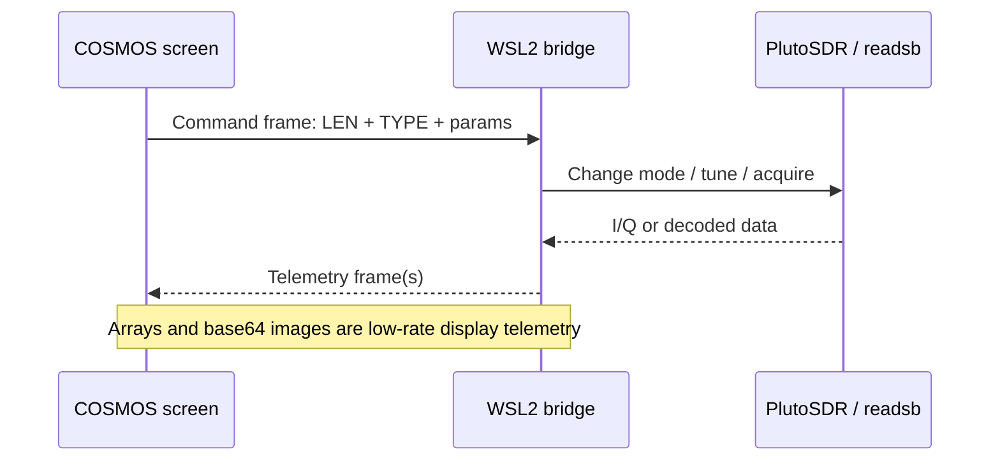

# COSMOS ↔ Pluto bridge protocol (v0.7.0)

> **Engineering reference, not a substitute for code.** The authoritative sources are `pluto-cosmos-starter/bridge/*.py` and `pluto-cosmos-starter/cosmos-plugin/targets/PLUTO_SDR/cmd_tlm/{cmd.txt,tlm.txt}`. When changing any field, update all definitions and tests together.

## Transport and framing

- One full-duplex TCP connection between the COSMOS plugin interface (`PLUTO_SDR_INT`) and the WSL2 Python bridge; default `host.docker.internal:7350` from the Docker side.
- Frames use **network byte order (big-endian)**. Every frame begins with a `uint32 LENGTH` (number of bytes in entire packet, including header), followed by `uint16 TYPE`.
- Command fields and telemetry fields then follow in **exact defined order**. There is no JSON on the COSMOS wire; readsb JSON is internal to WSL2.
- Receiver code builds frames with Python `struct.pack('>...')`, fixed-width ASCII strings, and float32 arrays. COSMOS `APPEND_PARAMETER`, `APPEND_ITEM`, `APPEND_ID_PARAMETER` and `APPEND_ID_ITEM` must match.
- The bridge's `decode_frames()` guards inbound **command** length at `MAX_FRAME=16384`. Some outbound image telemetry frames can be variable size; do **not** blindly apply that command limit to image packets.
- PNG imagery is base64 text stored as the final variable-length `APPEND_ITEM PNG_BASE64 0 STRING`. COSMOS renders it with `IMAGEVIEWER ... png`. Changing image type or field position requires coordinated changes.
- Numeric lat/lon and other telemetry floats are generally **float32**. This limits displayed precision versus original Python float64 and should not be used for sub-meter geolocation assumptions.

## Command IDs

| ID | COSMOS command | Byte length | Purpose |
| ---: | --- | ---: | --- |
| 100 | `PLUTO_SDR CONFIG` | 36 | Legacy spectrum configuration; retained for compatibility |
| 101 | `PLUTO_SDR START` | 6 | Start spectrum collection |
| 102 | `PLUTO_SDR STOP` | 6 | Stop spectrum collection |
| 103 | `PLUTO_SDR CLEAR_HOLD` | 6 | Clear peak-hold trace |
| 104 | `PLUTO_SDR CONFIG_V2` | 40 | Spectrum configuration with independent RF bandwidth |
| 105 | `PLUTO_SDR WF_RANGE` | 14 | Waterfall dBFS color scale limits |
| 106 | `PLUTO_SDR CLEAR_WF` | 6 | Clear waterfall history |
| 107 | `PLUTO_SDR ADSB_START` | 6 | Release bridge receiver; start `readsb` |
| 108 | `PLUTO_SDR ADSB_STOP` | 6 | Stop `readsb` and restore spectrum |
| 109 | `PLUTO_SDR MAP_CFG` | 22 | Home marker and fixed map latitude/longitude spans |
| 110 | `PLUTO_SDR CLEAR_TRACKS` | 6 | Clear ADS-B trails |
| 111 | `PLUTO_SDR FM_START` | 23 | Tune and play FM |
| 112 | `PLUTO_SDR FM_STOP` | 6 | Stop FM playback / restore spectrum |
| 113 | `PLUTO_SDR FM_TUNE` | 23 | Change FM frequency/gain/volume while playing |
| 114 | `PLUTO_SDR FM_OPTIONS` | 8 | Stereo and RDS enabled flags |

### Command body formats (Python `struct` syntax)

| Command IDs | Struct | Fields after header (`LENGTH`, `TYPE`) |
| --- | --- | --- |
| 100 | `>IHQIIIffBB` | center Hz (u64), display span Hz (u32), sample rate (u32), FFT size (u32), gain dB (f32), averages (f32), AGC (u8), FPS (u8) |
| 104 | `>IHQIIIffBBI` | Previous fields plus **RF bandwidth Hz** (u32) |
| 105 | `>IHff` | waterfall floor dBFS (f32), ceiling dBFS (f32) |
| 109 | `>IHffff` | home lat, home lon, lat span, lon span (four f32) |
| 111, 113 | `>IHQffB` | frequency Hz (u64), volume 0..1 (f32), gain dB (f32), AGC (u8) |
| 114 | `>IHBB` | stereo requested (u8), RDS requested (u8) |
| 101–103, 106–108, 110, 112 | `>IH` | no further fields |

### Example: minimal command frame

```python
import struct
clear_tracks = struct.pack('>IH', 6, 110)  # uint32 length 6 + uint16 TYPE 110
```

A new command should receive a new ID, a matching COSMOS schema, Python decoder branch, range checks and a test of bytes/semantics. Do not guess structure lengths from UI field count.

## Telemetry IDs

| ID | Packet | Length | Contents |
| ---: | --- | --- | --- |
| 1 | `SPECTRUM` | 4146 bytes | sequence, center/left/right MHz, MSPS/span, FFT/gain/peak/RBW, **512 f32 power** + **512 f32 hold** bins |
| 2 | `STATUS` | 74 bytes | last spectrum sequence; fixed 64-byte ASCII message |
| 3 | `WATERFALL` | variable | sequence, bounds, dBFS scale, row time/valid rows, **base64 PNG** |
| 4 | `ADSB_TABLE` | 990 bytes | sequence/time/count/totals/state, **12** fixed-width aircraft rows (9 string fields each) |
| 5 | `ADSB_EVENT` | 88 bytes | sequence and one aircraft row |
| 6 | `ADSB_MAP` | variable | sequence, lat/lon bounds, home coordinates/spans, track counts, **base64 PNG** |
| 7 | `FM_STATUS` | 126 bytes | frequency MHz, volume, audio/RF RMS, received buffers, state/detail strings |
| 8 | `FM_AUDIO_SPECTRUM` | 2066 bytes | sequence, audio bin resolution and rate, **256 f32 L** + **256 f32 R** bins |
| 9 | `FM_RDS` | 198 bytes | PI, station name, program type, RadioText, group count and decoder state |
| 10 | `FM_DSP` | 18 bytes | stereo requested, pilot locked, RDS enabled/running, pilot relative dB |

**Image header sizes in current Python implementation:** `WATERFALL_FMT='>IHI6fI'` = 38 bytes; `ADSB_MAP` prefix `'>IHI8fII'` = 50 bytes. These include the global six-byte frame header. Remaining bytes contain base64 PNG data.

For exact fixed-width aircraft row widths, read `COLUMNS` in `bridge/adsb.py` and `R01_...` through `R12_...` in `tlm.txt`—do not casually reorder them. Unknown fields should remain `'-'` in display, not fabricated coordinates/altitude.

## Command/telemetry flow



For a typical ADS-B poll, the bridge may emit several `ADSB_EVENT` (5) packets followed by `ADSB_TABLE` (4) and `ADSB_MAP` (6). FM data uses status (7), FFT (8), optional RDS (9) and DSP/pilot (10). Do **not** assume telemetry packet types arrive in numerical order or one packet per command.

## Testing protocol changes

1. In `pluto-cosmos-starter/`, run `python3 -m unittest discover -s tests -v`.
2. Verify Python `struct.calcsize(...)` equals COSMOS `LENGTH` and array sizes for every changed packet.
3. Run `python3 bridge/pluto_bridge.py --simulate --verbose` and confirm packet decoder continues to handle split and concatenated TCP command frames.
4. If changing any `cmd_tlm` or screen file, increment GEM version and **rebuild/reinstall** the plugin.
5. Check screens in COSMOS and real-hardware tuning/mode transitions. An automated packet test alone does **not** prove Docker/COSMOS integration.
6. Avoid unnecessary raw IQ/audio data over telemetry; monitor image packet sizes, send rate and long-term telemetry storage.

See [RELEASE_CHECKLIST.md](RELEASE_CHECKLIST.md) and [../DEVELOPMENT.md](../DEVELOPMENT.md).
